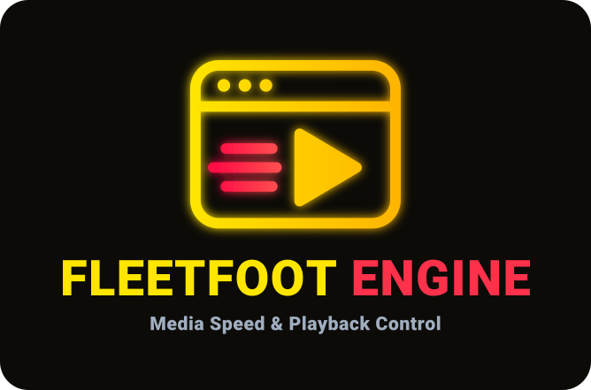
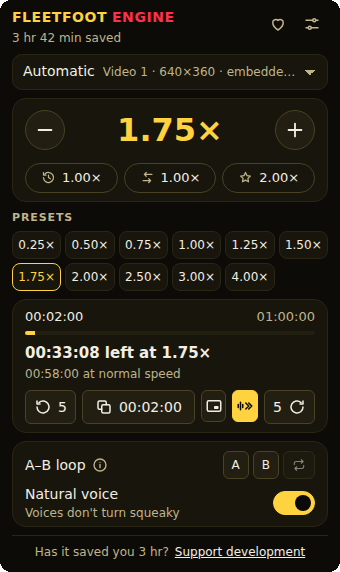

  

<strong>Fast, lightweight playback control for HTML5 video and audio.</strong>

  Nothing sent anywhere · No accounts · No analytics · No telemetry · No ads · Local-only settings

  
  
  

  

## FULL PRIVACY

This extension does not send your browsing activity anywhere.

**Don't trust us. Read the source.**

What it keeps, and why each permission is there: [PRIVACY.md](PRIVACY.md) and [docs/PERMISSIONS.md](docs/PERMISSIONS.md).

## What it does

- Changes the speed of any HTML5 video or audio, from 0.10× to 16×, with presets, a favorite speed and a speed you get while holding a key.
- Remembers nothing, one speed for every site, or a speed and a few settings per site: your choice.
- Shows the time left at the current speed, and how much time playing faster has saved you.
- Speeds through the silences when you turn it on. The sound is heard only on your device, never recorded or sent.
- Loops a part between two points, skips back and forward, and keeps voices natural when the speed changes.
- Works with several players on a page, players inside frames, and pages that load new videos without reloading.
- Runs only where you allow it: when you call it on a tab, on the sites you choose, or on every site.
- Eighteen languages, the browser's or the one you choose in the settings, ten color themes, and a
  settings page whose text you can enlarge up to 200%.

## Browsers

Chrome, Edge and other Chromium browsers; Firefox on desktop and on Android (142 or later).

## Where it cannot help

Works with standard HTML5 media and a broad range of custom players. It cannot work:

- on the browser's own pages and on the extension stores, which no extension may touch;
- on media that is not an HTML5 video or audio element;
- on sound or video that a page plays without putting it on the page;
- inside a frame from another site, until that site is allowed too: when a page's player is in such a frame, the popup names the site and offers to allow it;
- where a protected or site-specific player refuses an action;
- to skip silences where the browser keeps the sound from extensions, as it does with protected media and with many recordings that come from another site;
- with a feature the browser does not offer on that device.

Videos opened from your computer are outside the site choices: open FleetFoot Engine with a click on its icon. If Chrome keeps it out of these pages, turn on "Allow access to file URLs" on the extension's details page.

At very high or very low speeds, browsers may play audio differently, or mute it.

## Build from source

The store packages are built from this repository, by its `build` workflow, from the tag of each
version. Each GitHub release holds the packages, their SHA-256 in `SHA256SUMS`, and an attestation
of where they were built: `gh attestation verify <package> --repo buildwiserevenue/fleetfoot-engine`.

To build them yourself:

1. Install Node.js 24.15.0 (see `.node-version`) and pnpm 10.33.4 (see `packageManager` in `package.json`).
2. Run `pnpm install --frozen-lockfile`.
3. Run `pnpm build`.

The packages are written to `.output/`: one zip for Chrome (Edge takes the same one), one for
Firefox and one with the source. `pnpm verify` runs every check the project runs before a release;
it needs an audio output, because Firefox starts audio only where there is one.

To check that your build is the released one, check out the tag of that version, build it, put the
release's `SHA256SUMS` in the folder above `.output/`, and run `sha256sum -c ../SHA256SUMS` inside
`.output/`.

## Community

- Something does not work: open an issue in [Issues](https://github.com/buildwiserevenue/fleetfoot-engine/issues).
- A question or an idea: start a conversation in [Discussions](https://github.com/buildwiserevenue/fleetfoot-engine/discussions).
- A security problem: never in a public issue, see [SECURITY.md](SECURITY.md).

This repository does not take pull requests: see [CONTRIBUTING.md](CONTRIBUTING.md).

## Support

FleetFoot Engine is free. If it saves you time, you can [support its development on Ko-fi](https://ko-fi.com/lionrick333).

## License

[PolyForm Strict 1.0.0](LICENSE): free for personal and noncommercial use. Changing or redistributing the code is not allowed. The license text decides; this line only sums it up.

The FleetFoot Engine name and logo are not licensed: they may not be used, changed or reused without permission.
